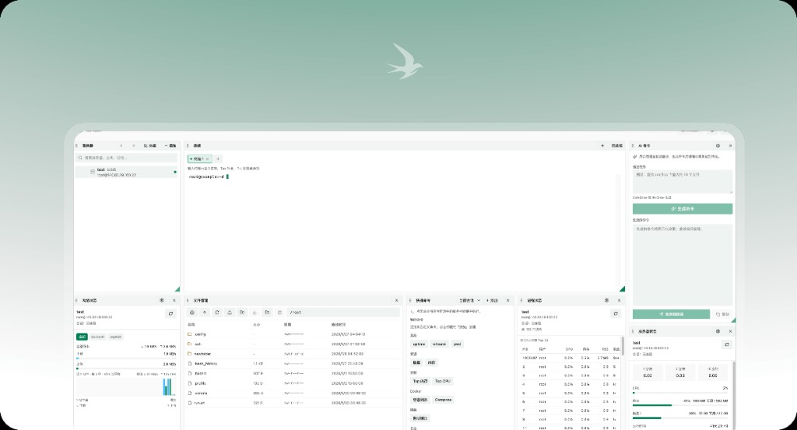

<p align="center">
  <picture>
    <source media="(prefers-color-scheme: dark)" srcset="web/public/logo-dark.png" />
    <source media="(prefers-color-scheme: light)" srcset="web/public/logo-light.png" />
    
  </picture>
</p>

<h1 align="center">ternssh</h1>

<p align="center">
  SSH workspace on Cloudflare<br />
  Draggable dashboard · Terminal · SFTP · Status monitoring
</p>

<p align="center">
  <a href="LICENSE">GPL-3.0-or-later</a>
  ·
  <a href="README.zh.md">中文</a>
</p>

<p align="center">
  <a href="https://deploy.workers.cloudflare.com/?url=https://github.com/haradakashiwa/ternssh-cloudflare-workers-template">
    
  </a>
</p>

<p align="center">
  <picture>
    <source media="(prefers-color-scheme: dark)" srcset="docs/preview-dark.png" />
    <source media="(prefers-color-scheme: light)" srcset="docs/preview-light.png" />
    
  </picture>
</p>

---

**ternssh** is an SSH management tool that runs on Cloudflare Edge. Full documentation: **[Docs](https://ternssh.com/docs/home)**.

## Deployment

### Docker quick start

Using the prebuilt image (recommended):

```bash
docker run -d \
  --name ternssh \
  -p 8787:8787 \
  -v ternssh-data:/app/.wrangler \
  --restart unless-stopped \
  ghcr.io/haradakashiwa/ternssh:latest
```

Or with Docker Compose:

```bash
docker compose -f docker-compose.ghcr.yml up -d
```

Build from source:

```bash
docker compose up -d --build
```

Open http://localhost:8787 after startup. To enable Cloudflare Access authentication, set the `ACCESS_TEAM_DOMAIN` and `ACCESS_AUD` environment variables.

### Cloudflare Workers

See the [deployment guide](https://ternssh.com/docs/deployment) for details.

## Cloudflare Tunnel

A server published through a Cloudflare Tunnel (the kind you reach with `cloudflared access ssh --hostname <host>`) can be added with the **Cloudflare Tunnel** connection type. Enter the tunnel's public hostname as the host; the tunnel's ingress rule decides the port. If Cloudflare Access protects the hostname, create a service token in Zero Trust, allow it in the application's policy with the **Service Auth** action, and enter its Client ID and Client Secret on the server. Browser sign-in and WARP private network routes are not supported. Apply D1 migration `0011_cloudflare_tunnel.sql` when upgrading.

## MCP access

Add **MCP Access** from the dashboard component menu. Select servers and confirm the selection. Each confirmation replaces the complete selection for this workspace. Ending authorization clears the selection for all paired clients. Removing the card only removes it from the dashboard.

In the card settings, copy the MCP endpoint and create a dedicated token. Store the token in your client's secure environment as `TERNSSH_MCP_TOKEN`. To register the endpoint with Codex, substitute the address shown on the card:

```sh
codex mcp add ternssh --url https://your-ternssh.example/mcp --bearer-token-env-var TERNSSH_MCP_TOKEN
```

The `list_authorized_servers` tool returns the IDs and display names in the current selection. Changing a server's SSH address, port or login invalidates its grant. Revoke a client token from the settings in the card.

Apply D1 migration `0010_mcp_access.sql` when upgrading. For a remote client, serve `/mcp` over HTTPS. If an upstream proxy such as Cloudflare Access also protects `/mcp`, the client must satisfy the proxy's authentication as well as send the TernSSH MCP token.

## Desktop client

[**ternssh desktop**](https://github.com/haradakashiwa/ternssh-desktop) is a native client for macOS and Windows: an SSH terminal and server manager with a native UI, no WebView.

- **Works on its own**: manage servers and local terminals on your machine without any site, with credentials in the system keychain.
- **Syncs with your ternssh sites**: add a site and its servers, groups and snippets appear in a tab of their own; changes made in the client are written back to the site. Sites behind Cloudflare Access open a sign-in window when asked, or take a service token.
- **Connects from your machine**: a site only syncs the SSH details, and no traffic goes through it.
- Terminal tabs, SFTP with an editor, snippets, live server status, a tray and a global hotkey.

<p align="center">
  
</p>

### Download

Get the latest from [Releases](https://github.com/haradakashiwa/ternssh-desktop/releases/latest):

| System | File |
|---|---|
| macOS (Apple silicon and Intel) | `ternssh-<version>-macos-universal.dmg` |
| Windows x64 | `…-windows-amd64-setup.exe` (installer) or `…-windows-amd64-portable.zip` |
| Windows ARM64 | `…-windows-arm64-setup.exe` or `…-windows-arm64-portable.zip` |

The builds are not signed with a developer certificate: on macOS, right-click the app and choose "Open" the first time; on Windows, if SmartScreen warns, click "More info" → "Run anyway". Syncing a site needs a recent ternssh, which gives the client the servers' credentials.
