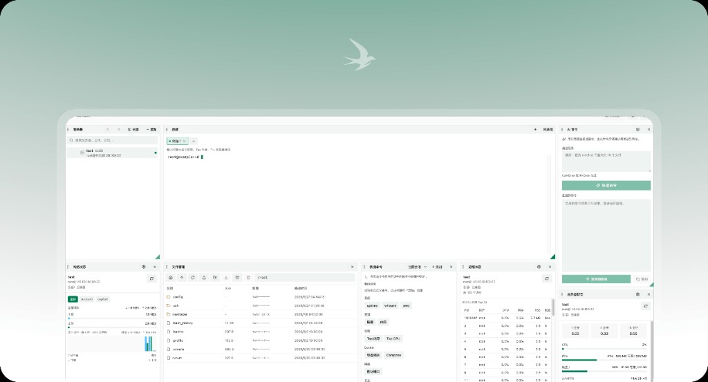

<p align="center">
  <picture>
    <source media="(prefers-color-scheme: dark)" srcset="web/public/logo-dark.png" />
    <source media="(prefers-color-scheme: light)" srcset="web/public/logo-light.png" />
    
  </picture>
</p>

<h1 align="center">ternssh</h1>

<p align="center">
  基于 Cloudflare 的 SSH 工作台<br />
  可拖拽仪表盘 · 终端 · SFTP · 状态监控
</p>

<p align="center">
  <a href="LICENSE">GPL-3.0-or-later</a>
  ·
  <a href="README.md">English</a>
</p>

<p align="center">
  <a href="https://deploy.workers.cloudflare.com/?url=https://github.com/haradakashiwa/ternssh-cloudflare-workers-template">
    
  </a>
</p>

<p align="center">
  <picture>
    <source media="(prefers-color-scheme: dark)" srcset="docs/preview-dark.png" />
    <source media="(prefers-color-scheme: light)" srcset="docs/preview-light.png" />
    
  </picture>
</p>

---

**ternssh** 是一款运行在 Cloudflare Edge 上的 SSH 管理工具。完整文档见 **[文档](https://ternssh.com/docs/home)**。

## 部署

### Docker 一键启动

使用预构建镜像（推荐）：

```bash
docker run -d \
  --name ternssh \
  -p 8787:8787 \
  -v ternssh-data:/app/.wrangler \
  --restart unless-stopped \
  ghcr.io/haradakashiwa/ternssh:latest
```

或使用 Docker Compose：

```bash
docker compose -f docker-compose.ghcr.yml up -d
```

从源码构建：

```bash
docker compose up -d --build
```

启动后访问 http://localhost:8787。如需启用 Cloudflare Access 认证，可添加环境变量 `ACCESS_TEAM_DOMAIN` 与 `ACCESS_AUD`。

### Cloudflare Workers

详见 [部署指南](https://ternssh.com/docs/deployment)。

## MCP 接入

从「添加组件」加入「MCP 接入」卡片，选择服务器并点击「确认授权」。每次确认都会替换工作区的整份名单。所有已配对客户端共享当前名单。「结束本次授权」会清空名单，移除卡片后可重新添加以继续管理。

在卡片设置中复制接入地址并创建专用令牌，将令牌保存到客户端的安全环境变量 `TERNSSH_MCP_TOKEN`。将下面示例地址替换为卡片显示的地址，即可在 Codex 注册。

```sh
codex mcp add ternssh --url https://your-ternssh.example/mcp --bearer-token-env-var TERNSSH_MCP_TOKEN
```

`list_authorized_servers` 返回本次已确认服务器的标识和显示名。更换 SSH 地址、端口或登录账号后需要重新确认授权。客户端令牌可在卡片设置中撤销。

升级已有实例时需要应用 D1 迁移 `0010_mcp_access.sql`。远程客户端应通过 HTTPS 访问 `/mcp`。若 Cloudflare Access 等上游代理也保护 `/mcp`，客户端除了发送 TernSSH MCP 令牌，还需要通过代理的身份验证。

## 桌面客户端

[**ternssh desktop**](https://github.com/haradakashiwa/ternssh-desktop) 是 ternssh 的原生桌面客户端，支持 macOS 和 Windows：SSH 终端与服务器管理工具，界面为原生 UI，没有 WebView。

- **本机即可使用**：不添加站点也能管理服务器和本地终端，凭据存在系统钥匙串。
- **与站点同步**：添加 ternssh 站点后，站点上的服务器、分组和快捷指令出现在独立的标签里，在客户端的修改会写回站点。站点受 Cloudflare Access 保护时，会弹出登录窗口，也可以使用服务令牌。
- **所有连接都从本机发起**：站点只用来同步 SSH 信息，不经它转发流量。
- 多标签终端、SFTP 与文件编辑器、快捷指令、服务器状态实时监控、托盘与全局快捷键。

<p align="center">
  
</p>

### 下载

在 [Releases](https://github.com/haradakashiwa/ternssh-desktop/releases/latest) 下载最新版本：

| 系统 | 文件 |
|---|---|
| macOS（Apple 芯片与 Intel） | `ternssh-<版本>-macos-universal.dmg` |
| Windows x64 | `…-windows-amd64-setup.exe`（安装包）或 `…-windows-amd64-portable.zip`（免安装） |
| Windows ARM64 | `…-windows-arm64-setup.exe` 或 `…-windows-arm64-portable.zip` |

安装包没有开发者证书签名：macOS 首次打开时请右键应用选「打开」；Windows 若出现 SmartScreen 提示，点「更多信息」→「仍要运行」。同步站点需要较新版本的 ternssh（客户端需要从站点获取服务器凭据）。
